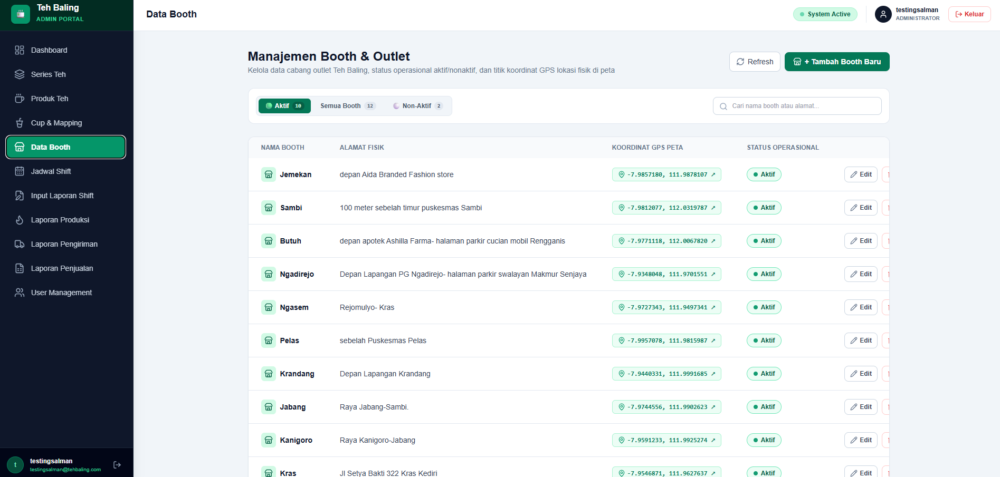
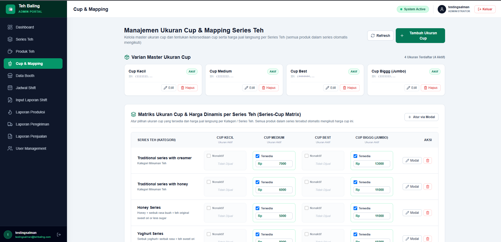
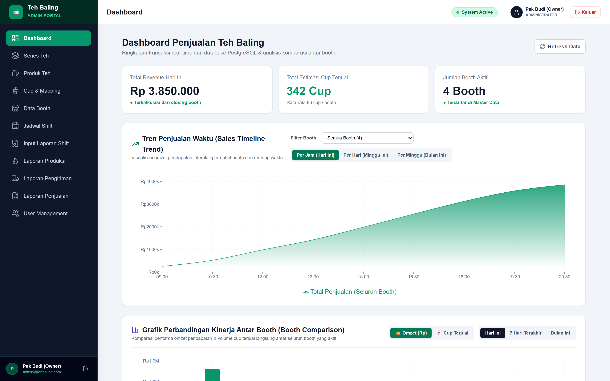
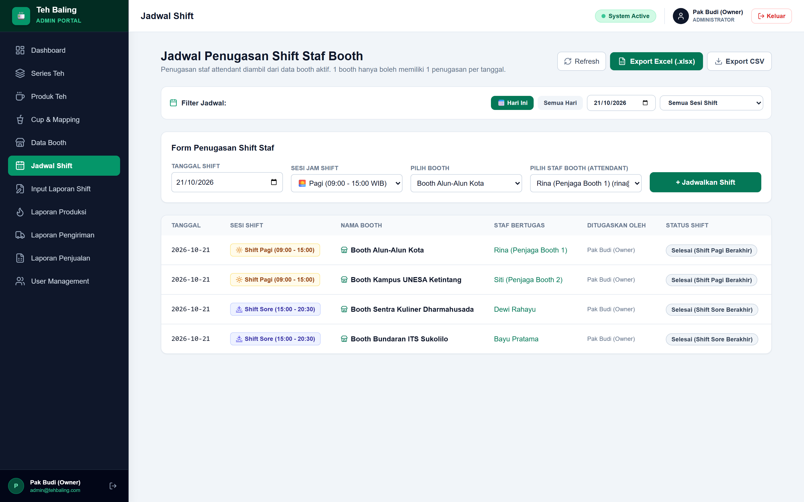
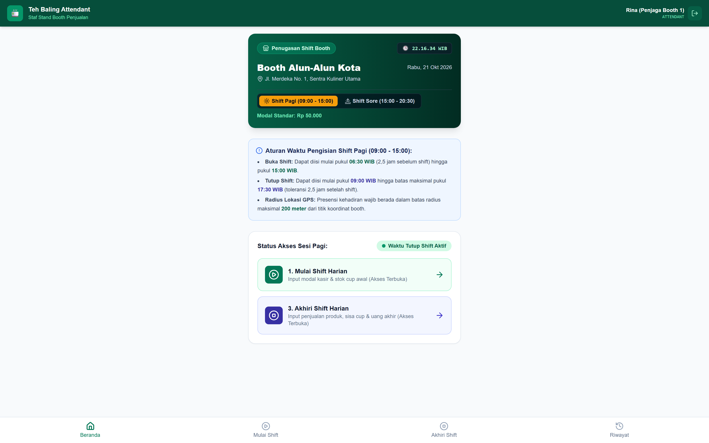
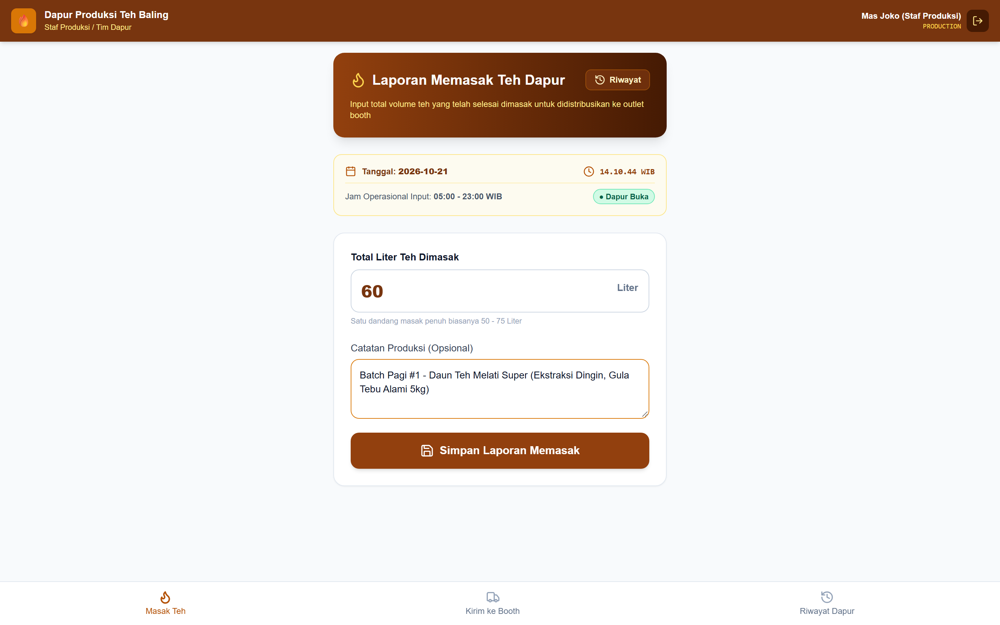
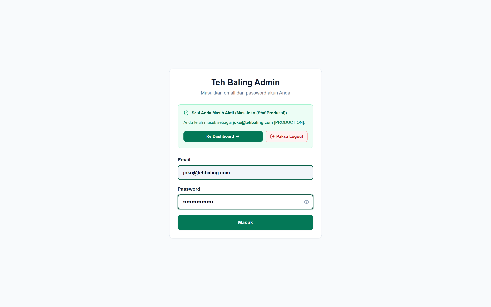

<p align="center">
  
  
  
  
  
</p>

# 🍵 Teh Baling — Multi-Outlet Booth Operations ERP

> Sistem ERP operasional end-to-end yang dibangun untuk jaringan cabang gerai minuman (multi-branch outlet) guna mengelola sebaran cabang booth, presensi berbasis geofencing GPS, pelacakan audit stok cup, dan analitik performa penjualan terpusat secara real-time.

---

## 📸 Screenshots & Antarmuka Sistem Terkini

Tangkapan layar antarmuka sistem (High-DPI) dari portal operasional Teh Baling:

### 1. 🗺️ Manajemen Cabang Booth & Titik Koordinat GPS
<p align="center">
  
  <br/>
  <em>Manajemen Sebaran Cabang Booth: Pendataan 10 titik cabang aktif (Jemekan, Sambi, Butuh, Ngadirejo, Ngasem, Pelas, Krandang, Jabang, Kanigoro, Kras), alamat fisik, titik koordinat GPS peta, serta toggle status operasional.</em>
</p>

---

### 2. 🍵 Manajemen Master Ukuran Cup & Matriks Harga Dinamis
<p align="center">
  
  <br/>
  <em>Matriks Kategori & Harga: Konfigurasi varian ukuran cup (Cup Kecil, Medium, Best, Biggg Jumbo) serta matriks harga jual per kategori series teh (Traditional series, Honey series, Yoghurt series).</em>
</p>

---

### 3. 📍 Modul Operasional & Antarmuka Lainnya

| Modul | Tampilan Antarmuka | Deskripsi Fitur |
|---|---|---|
| **Executive Sales Analytics** |  | Visualisasi tren omzet per jam, per hari, dan komparasi performa pendapatan antar cabang outlet. |
| **Presensi Geofencing GPS**<br/>*(Formula Haversine)* |  | Verifikasi kehadiran staf/penjaga stand secara akurat dengan batas toleransi radius 200m dari titik koordinat booth cabang untuk mencegah *fake attendance*. |
| **Portal Penugasan Shift Booth**<br/>*(Role: Penjaga Booth)* |  | Dashboard operasional barista/kasir: penugasan outlet harian, pemilihan sesi shift (Pagi/Sore), checklist kesiapan outlet, dan modal awal kasir aktif. |
| **Portal Dapur & Masak Teh**<br/>*(Role: Tim Produksi)* |  | Modul staf dapur pusat untuk pencatatan batch memasak teh (liter), catatan bahan baku, integrasi stok induk, dan pembatasan jam input operasional. |
| **Login Otorisasi Penjaga Booth** |  | Portal login khusus staf outlet dengan role guard `BOOTH_ATTENDANT`, JWT session handling, dan redirect langsung ke terminal kasir aktif. |
| **Login Otorisasi Tim Produksi** |  | Portal login staf dapur dengan role guard `PRODUCTION`, session guard otomatis, dan proteksi hak akses menu administrasi. |

---

## ✨ Fitur Unggulan

### 🗺️ Peta Pemetaan Cabang & Status Booth (GIS)
- Pemetaan visual seluruh titik booth outlet menggunakan **Leaflet OpenStreetMap**.
- Menampilkan status langsung (Aktif, Shift Tutup, Maintenance) dengan custom marker ikonik.
- Detail cepat performa penjualan dan shift yang sedang bertugas per booth.

### 📍 Presensi Geofencing GPS (Formula Haversine)
- Mencegah kecurangan presensi (*fake GPS / clock-in dari luar outlet*) dengan perhitungan jarak radius presisi (200m) dari titik koordinat booth.
- Perekaman timestamp kedatangan, keterlambatan, dan jam kepulangan shift kerja.

### 📊 Dashboard Analitik Multi-Cabang (Recharts)
- Grafik visual perbandingan omzet harian, mingguan, dan bulanan antar cabang outlet.
- Analisis *peak hours* (jam-jam tersibuk) untuk alokasi staf dan stok yang efisien.
- Metrik Best Selling Series (varian rasa terlaris) dan efisiensi konversi cup.

### 📦 Audit & Pengawasan Mutasi Stok Cup
- Pencatatan stok awal, restock harian dari gudang pusat, dan stok terpakai berbasis transaksi kasir.
- Deteksi otomatis deviasi/selisih (*discrepancy alert*) untuk mencegah kebocoran bahan baku.
- Dukungan ekspor laporan resmi harian/bulanan ke format **Microsoft Excel (.xlsx)** via ExcelJS.

### 🍵 Portal Operasional Penjaga Booth (Barista / Kasir)
- Autentikasi berbasis JWT dengan otorisasi role terproteksi `BOOTH_ATTENDANT`.
- Tampilan penugasan booth harian otomatis, verifikasi sesi shift (Pagi/Sore), serta pencatatan modal awal kasir.
- Modul restock inventaris cup langsung dari outlet dengan validasi stok terintegrasi.

### 🔥 Modul Produksi & Distribusi Dapur (Kitchen Staf)
- Portal terisolasi role `PRODUCTION` dengan pembatasan jam operasional input (05:00 - 23:00 WIB).
- Form pelaporan volume masak teh harian (liter) dan catatan varian batch bahan baku.
- Integrasi riwayat memasak dan modul pengiriman bahan baku ke seluruh titik cabang booth.

---

## 🛠️ Tech Stack

- **Framework:** [Next.js 14](https://nextjs.org/) (App Router & Server Components)
- **Language:** [TypeScript](https://www.typescriptlang.org/) (Strict type safety)
- **Styling:** [Tailwind CSS](https://tailwindcss.com/)
- **GIS Mapping:** [Leaflet](https://leafletjs.com/) & [React Leaflet](https://react-leaflet.js.org/)
- **Data Visualization:** [Recharts](https://recharts.org/)
- **Icons:** [Lucide React](https://lucide.dev/)
- **Data Export:** [ExcelJS](https://github.com/exceljs/exceljs)

---

## 🚀 Memulai (Local Development)

### 1. Prasyarat
- Node.js >= 18.x
- Backend API Teh Baling berjalan (port 3001 atau sesuai konfigurasi)

### 2. Instalasi Dependensi
```bash
git clone https://github.com/Salman-artz/teh-baling-frontend.git
cd teh-baling-frontend
npm install
```

### 3. Konfigurasi Environment Variable
Buat file `.env.local` pada direktori root:
```env
NEXT_PUBLIC_API_URL=http://localhost:3001/api
```

### 4. Jalankan Development Server
```bash
npm run dev
```
Buka browser di [http://localhost:3000](http://localhost:3000).

---

## 📂 Struktur Proyek

```
teh-baling-frontend/
├── public/
│   └── screenshots/          # Tangkapan layar antarmuka sistem (High-DPI)
│       ├── foto1_peta_booth_leaflet.png
│       ├── foto2_presensi_geofencing_gps.png
│       ├── foto3_dashboard_analitik_recharts.png
│       ├── foto4_audit_stok_cup.png
│       ├── foto5_login_role_penjaga_booth.png
│       ├── foto6_portal_penjaga_booth.png
│       ├── foto7_login_role_tim_produksi.png
│       └── foto8_portal_tim_produksi.png
├── src/
│   ├── app/                  # Next.js 14 App Router pages & layouts
│   │   ├── (auth)/login/     # Halaman login otentikasi
│   │   ├── (dashboard)/      # Portal Admin & Operasional
│   │   │   ├── analytics/    # Visualisasi Recharts
│   │   │   ├── audit-stok/   # Modul rekonsiliasi cup
│   │   │   ├── booths/       # Manajemen booth & peta GIS
│   │   │   └── presensi/     # Monitoring geofencing GPS
│   ├── components/           # UI Components (Sidebar, Navbar, Cards)
│   ├── hooks/                # Custom React Hooks
│   ├── lib/                  # Utilitas API client & formatters
│   └── types/                # Definisi TypeScript interface
├── package.json
└── tailwind.config.ts
```

---

## 👤 Author

**Muhammad Salman Alfarizy Yonda Putra**
- GitHub: [@Salman-artz](https://github.com/Salman-artz)
- LinkedIn: [linkedin.com/in/muhammad-salman-alfarizy](https://linkedin.com)
